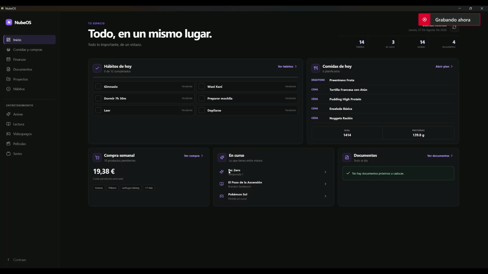
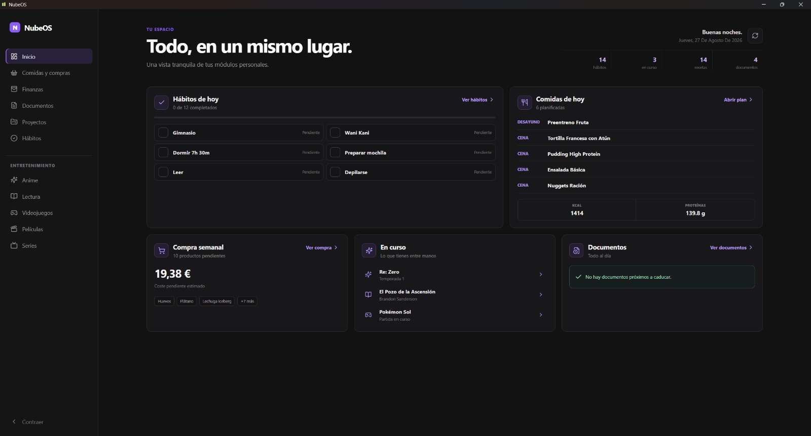
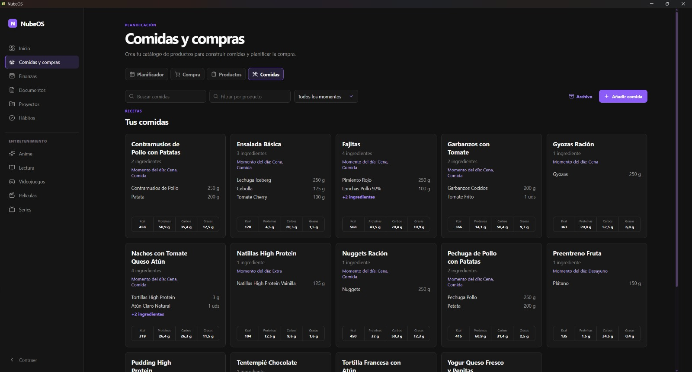
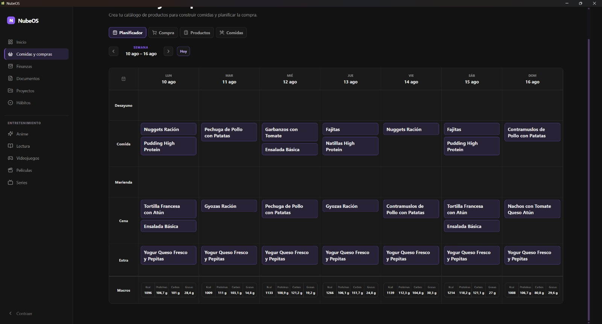
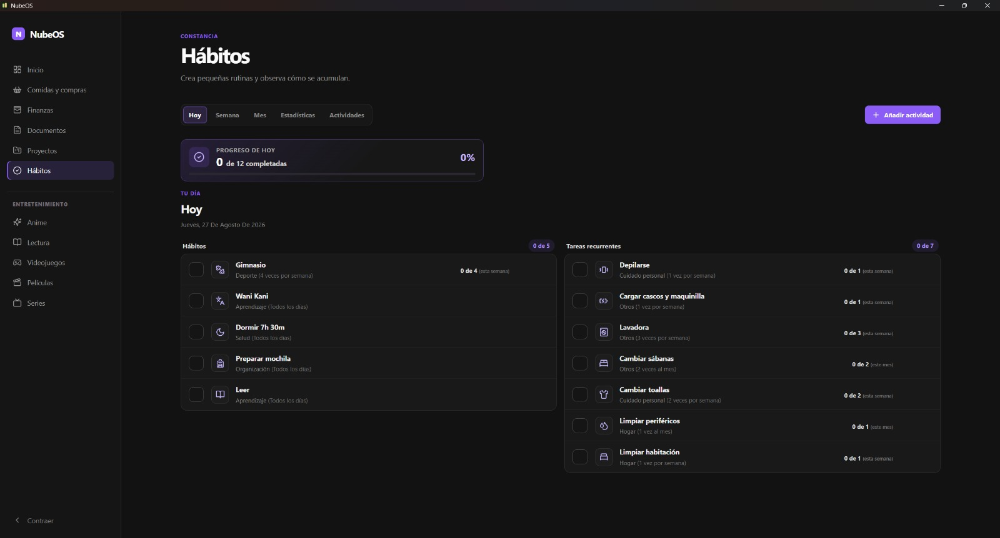
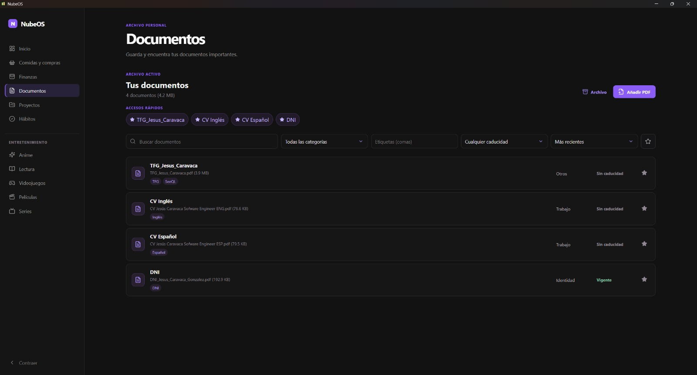
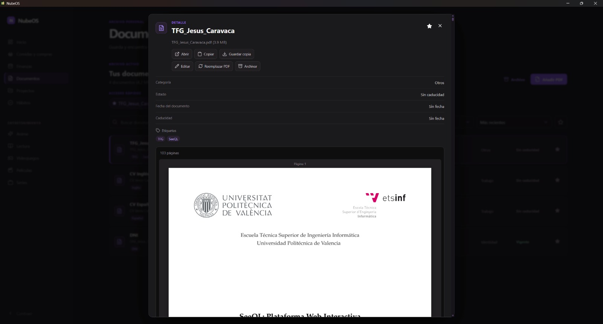
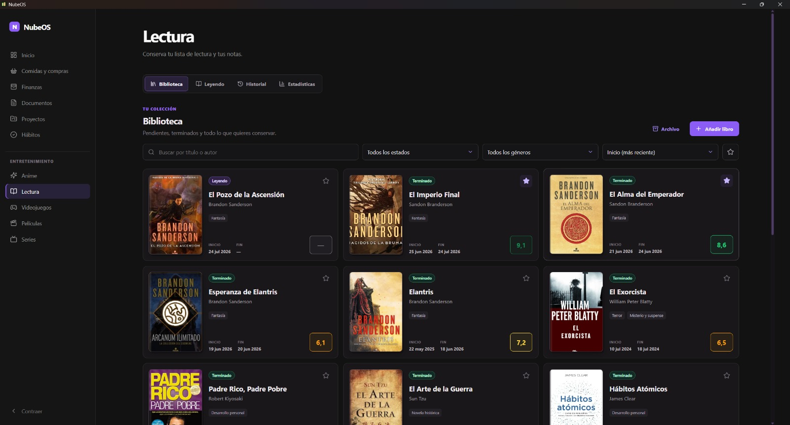
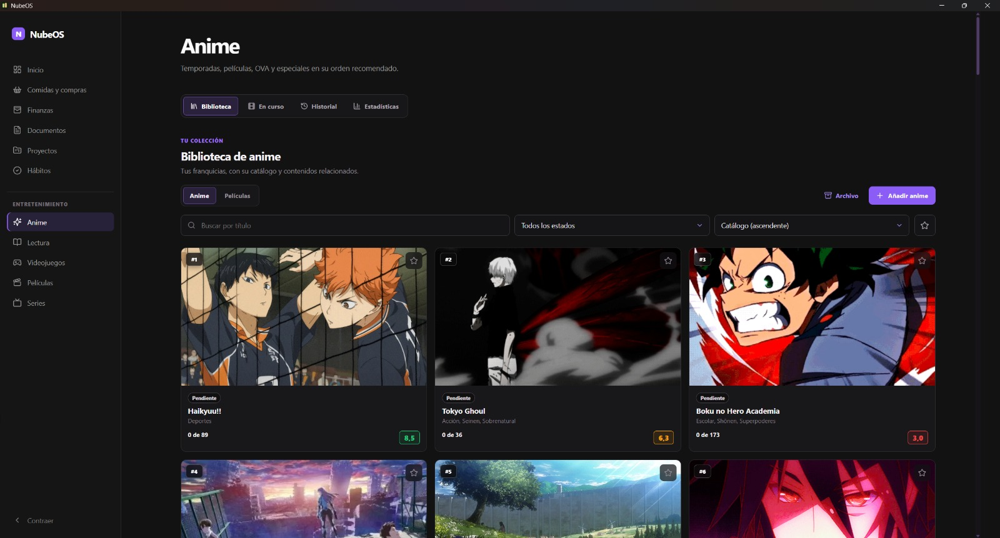
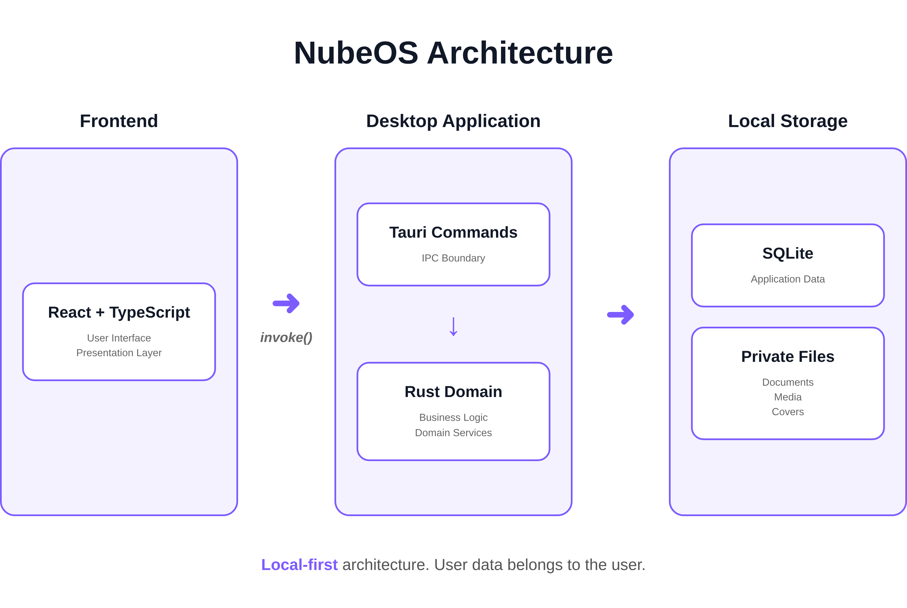

<div align="center">

# NubeOS

### My Personal Productivity Operating System

**One application. Everything I need. Nothing I don't.**

A local-first desktop application that replaces the dozens of tools I used every day with a single, unified workspace tailored to my own workflow.

Built with **React, Tauri, Rust and SQLite**.

<br>


<br><br>



</div>

---

# Why I built NubeOS

Over the years I ended up relying on dozens of different applications.

One app for habits.

Another for meal planning.

Another for finances.

Another for reading.

Another for documents.

Another for anime.

None of them worked together, many required subscriptions, and all forced me to adapt to someone else's workflow.

So I decided to build the software I actually wanted.

**NubeOS is my own operating system for everyday life.**

Every module exists because I genuinely use it.

Nothing is included unless it solves a real problem for me.

**Instead of adapting my workflow to existing software, I built software that adapts to my workflow.**

---

# ✨ Features

- 🏠 Unified personal dashboard
- 🍽 Meal planner with automatic shopping list generation
- 💰 Personal finance module *(planned)*
- 📄 Private document manager with built-in PDF viewer
- ✅ Habit tracker
- 📚 Reading library and statistics
- 🎮 Video game tracker
- 🎬 Movie tracker
- 📺 TV series tracker
- 🍿 Anime tracker
- 📦 Local-first architecture
- 🔒 No cloud dependency
- ⚡ Native desktop performance

---

# 📸 Screenshots

## Dashboard

Everything important at a glance.

<p align="center">

</p>

## Meals

Manage recipes, ingredients and nutritional information.

<p align="center">

</p>

## Weekly Planner

Plan your meals for the week and automatically generate your shopping list.

<p align="center">

</p>

## Habit Tracking

Track recurring habits and monitor long-term consistency.

<p align="center">

</p>

## Document Management

Store important documents with categories, tags and expiration dates.

<p align="center">

</p>

## Built-in PDF Viewer

Preview your documents without leaving the application.

<p align="center">

</p>

## Reading Library

Track books, reading sessions and personal ratings.

<p align="center">

</p>

## Entertainment Library

Manage your anime collection, watch progress and ratings.

<p align="center">

</p>

---

# 🏗 Architecture

NubeOS follows a **local-first desktop architecture**.

The user interface is built with React, while all business logic lives in Rust behind Tauri commands.

SQLite stores structured application data, while PDFs, covers and other media are managed as private local files.

No backend server is required.

<p align="center">

</p>

### Why this architecture?

- 🔒 Complete data ownership
- ⚡ Native desktop performance
- 📦 Works entirely offline
- 🧠 Strong separation between UI and business logic
- 🚀 Easily extensible through independent modules

---

# 🛠 Tech Stack

| Category | Technologies |
|-----------|--------------|
| Frontend | React · TypeScript · Vite |
| Desktop | Tauri |
| Backend | Rust |
| Database | SQLite |
| Styling | CSS |
| Tooling | pnpm · Cargo |

---

# 🚀 Running locally

```bash
git clone https://github.com/MagicNube/NubeOS.git

cd NubeOS

pnpm install

pnpm tauri dev
```

---

# 📖 Documentation

The project includes detailed documentation covering:

- Vision
- Architecture
- Design principles
- Module specifications
- Architecture Decision Records (ADRs)
- Roadmap
- Development notes

See the `docs/` directory for the complete documentation.

---

# 🚧 Project Status

NubeOS is my long-term personal project and is under active development.

New modules and improvements are continuously added as my own workflow evolves.

---

# 📄 License

MIT
